# Consent Manager

After a certain period, bank customers may need to view, update, or revoke consents they have granted to API consumer applications to access account data. **Consent Manager** is an application in WSO2 Open Banking that supports all these requirements and manages consents.

note

* Bank officers with the `CustomerCareOfficerRole` role and bank customers can access the Consent Manager.
* Customer Care Officers have privileges such as Advanced Search options and the ability to view the consents of all bank customers.

## Configuring servers[​](#configuring-servers "Direct link to Configuring servers")

1. Open the `<IS_HOME>/repository/conf/deployment.toml` file and update access control configurations for the `consentmgr` resource as follows:

   ```
   [[resource.access_control]]

   context = "(.*)/consentmgr(.*)"

   secure="false"

   http_method="GET,DELETE"
   ```

2. Open the `<APIM_HOME>/repository/conf/deployment.toml` file and add the following gateway executor configurations for the Consent flow:

   ```
   [[open_banking.gateway.openbanking_gateway_executors.type]]

   name = "Consent"

   [[open_banking.gateway.openbanking_gateway_executors.type.executors]]

   name = "com.wso2.openbanking.accelerator.gateway.executor.impl.selfcare.portal.UserPermissionValidationExecutor"

   priority = 1
   ```

3. Restart the Identity Server and API Manager servers respectively.

## Creating users and roles[​](#creating-users-and-roles "Direct link to Creating users and roles")

Follow [Configuring users and roles](/en/latest/install-and-setup/configuring-users-and-roles/.md) and do the following:

1. Create a user and assign the `CustomerCareOfficerRole` role.

2. Create 2 other users and assign them only the `Internal/subscriber` role.

## Publishing Self-Care Portal API[​](#publishing-self-care-portal-api "Direct link to Publishing Self-Care Portal API")

1. Sign in to the API Publisher Portal at `https://<APIM_HOST>:9443/publisher` with `creator/publisher` privileges.

2. On the homepage, go to **REST API** and select **Import Open API**. 

3. Select **OpenAPI File/Archive**.

4. Download the `scp-swagger.yaml` file available [here ](../../assets/attachments/scp-swagger.yaml).

5. Click **Browse File to Upload** and use the `scp-swagger.yaml` file.

6. Click **Next**.

7. Set the value for **Endpoint** as follows:

   ```
   https://<IS_HOST>:9446/api/openbanking/consent
   ```

   * Replace the placeholder with the hostname of Identity Server.

8. Click **Create**.

9. Go to **Portal Configurations > Subscriptions > Select Business Plan as 'Unlimited'** using the left menu pane.

10. Go to **Develop -> API Configurations -> Policies** in the left menu pane. 

11. Go to **Develop -> API Configurations -> Policies** in the left menu pane. 

12. On the **Policy List** card, click on **Add New Policy**.

13. Fill in the **Create New Policy**.

14. Download the `scp-insequence.xml` file available [here ](../../assets/attachments/scp-insequence.xml)and use it as the Mediation Policy.

15. Upload the `scp-insequence.xml` file and click **SELECT**.

16. Scroll down and click **Save**. Upon successful creation of the policy, you receive an alert as shown below: 

17. Expand the API endpoint you want from the list of API endpoints.

18. Expand the HTTP method from the API endpoint you selected.

19. Drag and drop the previously created policy to the **Request Flow** of the API endpoint. For example, 

20. Select **Apply to all resources** and click **Save**.

21. Scroll down and click **Save**.

22. Go to **Overview** using the left menu pane.

23. Click **Deploy**.

24. Set the API Gateways configurations and deploy the API.

25. Go back to **Overview**.

26. Click **Publish**.

## Subscribing to Self-Care Portal API[​](#subscribing-to-self-care-portal-api "Direct link to Subscribing to Self-Care Portal API")

1. Sign in to the Developer Portal at `https://<APIM_HOST>:9443/devportal` with `Internal/subscriber` privileges.

2. Go to the **Applications** tab and click **ADD NEW APPLICATION**. 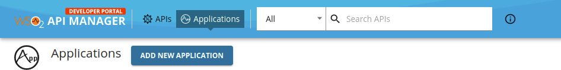

3. Enter `consentmgr` as the name of the application and click **Save**. 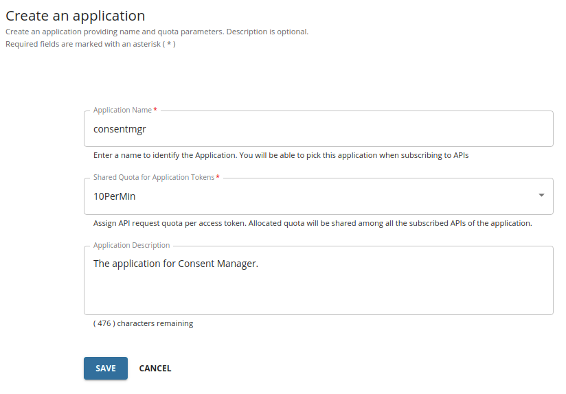

4. Go to the left menu pane and select **Production Keys** or **Sandbox Keys** to generate keys.

5. Set the **Grant Types** to **Refresh Token** and **Code**.

   [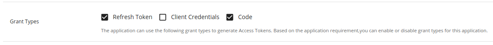](/en/latest/assets/img/learn/consent-manager/generate-keys.png)

   If these grant types are not visible in the Developer Portal, click here to see how to configure them.

   Follow the steps below and configure the Grant Types for the Key Manager according to your Open Banking specification:

   1. Sign in to the Admin Portal of API Manager at `https://<APIM_HOST>:9443/admin`.

   2. Go to the `Key Managers` tab using the left menu pane.

   3. Select the **OBKM** key manager. 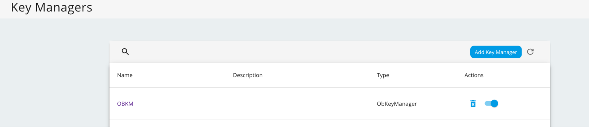

   4. Enter the required grant types and press enter. 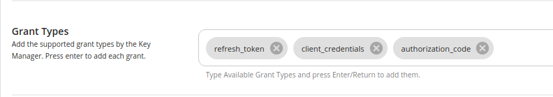

   5. Scroll down and click **Update**.

   For more information see, [Configure Identity Server as the Key Manager](/en/latest/learn/dynamic-client-registration-try-out/#step-2-configure-is-as-key-manager).

6. Set the **Callback URL** to `https://<IS_HOST>:9446/consentmgr/scp_oauth2_callback`.

   * Replace the placeholder with the hostname of the Identity Server.

7. Leave their default values for other configurations.

8. Scroll down and click **GENERATE KEYS**.

9. A message box will display the access token.

10. You can see that the consumer key and consumer secret are generated for the `consentmgr` application.

11. Now, go to the left menu pane and select **Subscriptions**.

12. Click **SUBSCRIBE APIS**. 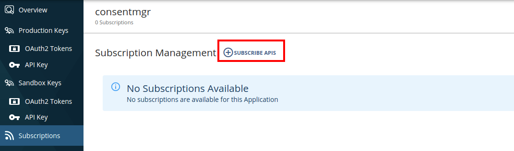

13. Find the **SelfCarePortalAPI** from the list and click the **Subscribe** button corresponding to it.

14. If you are using **WSO2 Identity Server 6.0.0**, follow the below instructions:

    1. Sign in to the Management Console at `https://<IS_HOST>:9446/carbon/`.

    2. In the **Main** tab, click **Identity -> Service Providers -> List**.

    3. Select the Service Provider of the `consentmgr` application, and click the corresponding **Edit** icon.

    4. Expand the **Claim Configuration** section.

    5. Select **<http://wso2.org/claims/username>** from the **Subject Claim URI** list.

    6. Click **Update** to save the configurations.

## Configuring Consent Manager[​](#configuring-consent-manager "Direct link to Configuring Consent Manager")

1. Open the `<IS_HOME>/repository/deployment/server/webapps/consentmgr/runtime-config.js` file.

   * Update the `SERVER_URL` parameter with a URL to the Identity Server. For example:

     ```
     window.env = {

         // This option can be retrieved in "src/index.js" with "window.env.API_URL".

         SERVER_URL: 'https://<IS_HOST>:9446',

         TENANT_DOMAIN: 'carbon.super',

         NUMBER_OF_CONSENTS: 25,

         VERSION: '3.0.0'

       };
     ```

2. Open the `<IS_HOME>/repository/deployment/server/webapps/consentmgr/WEB-INF/web.xml` file.

   | Configuration         | Description                                                                             |
   | --------------------- | --------------------------------------------------------------------------------------- |
   | identityServerBaseUrl | The hostname of the Identity Server.                                                    |
   | apiManagerServerUrl   | The hostname of the API Manager.                                                        |
   | scpClientKey          | The Consumer Key of the [application created](#subscribing-to-self-care-portal-api).    |
   | scpClientSecret       | The Consumer Secret of the [application created](#subscribing-to-self-care-portal-api). |

   For example,

   ```
   <context-param>

       <param-name>identityServerBaseUrl</param-name>

       <param-value>https://<IS_HOST>:9446</param-value>

   </context-param>

   <context-param>

       <param-name>apiManagerServerUrl</param-name>

       <param-value>https://<APIM_HOST>:8243</param-value>

   </context-param>

   <context-param>

       <param-name>scpClientKey</param-name>

       <param-value>2zB5s9wGHWVwmlrvHdWa6Mwc4vsa</param-value>

   </context-param>

   <context-param>

       <param-name>scpClientSecret</param-name>

       <param-value>cqblprasAniVfi02IXGFvp8VREAa</param-value>

   </context-param>
   ```

## Using Consent Manager[​](#using-consent-manager "Direct link to Using Consent Manager")

1. Go to the Consent Manager application at `https://<IS_HOST>:9446/consentmgr`

2. Sign in with the credentials provided by the bank.

3. The `consentmgr` application requests access to your profile. To grant access, click **Continue**.

   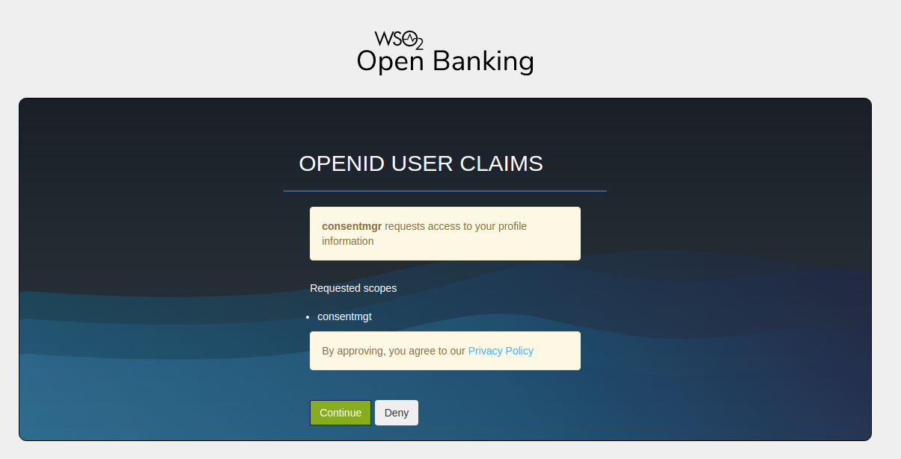

4. You are redirected to the homepage of the Consent Manager portal.

   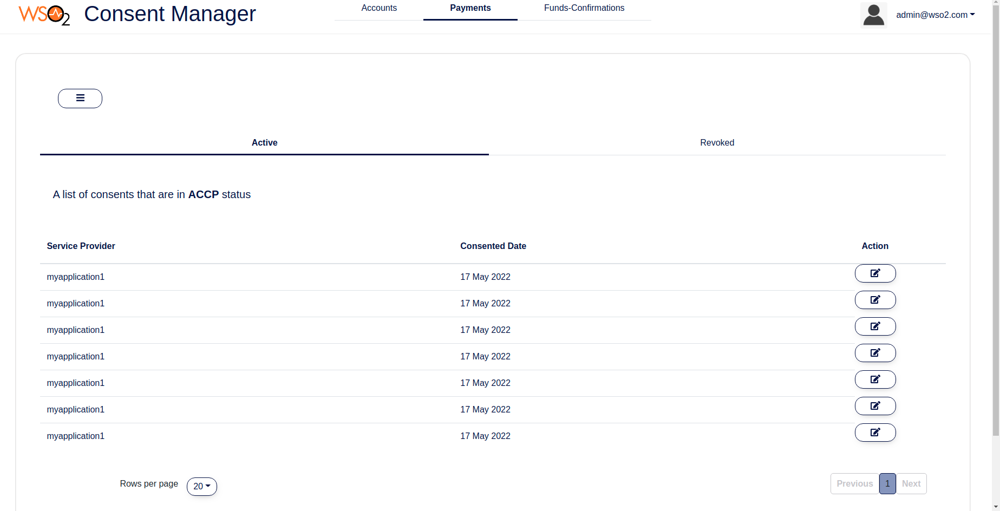

5. There three tabs for as **Accounts**, **Payments** and **Funds Confirmations** consents.

6. Under each consent type there are two tabs:

   * **Active**: Lists active consents that can access your account/payment information.
   * **Revoked**: Lists the consents that you have revoked.

tip

Use the **Search** button to search consents. ![search consent](data:image/png;base64,iVBORw0KGgoAAAANSUhEUgAAACAAAAAUCAMAAADbT899AAAMZmlDQ1BpY2MAAEjHlVcHWFPJFp5bkpCQ0AIISAm9CSI1gJQQWgDpRbARkkBCCTEhqNjRRQXXLqJY0VURxbYCYseuLIoN+2JBRVkXdVEUlTchAV133/e+d75v7v1z5sx/yp3JvQcAzV6uRJKLagGQJy6QxocFMcampjFIzwACMEAFJGDH5ckkrNjYKABl8P53eX8LWkO57qTgAv+f6PAFMh4AyHiIM/gyXh7EJwHA1/Mk0gIAiAq95ZQCiQLPgVhXCgOEeJUCZynxTgXOUOKjAzaJ8WyIrwKgRuVypVkAaNyHekYhLwvyaHyG2EXMF4kB0BwBsT9PyOVDrIh9RF5evgJXQGwH7SUQw3gAM+M7zqy/8WcM8XO5WUNYmdeAqAWLZJJc7rT/szT/W/Jy5YM+bOCgCqXh8Yr8YQ1v5+RHKjAV4i5xRnSMotYQ94r4yroDgFKE8vAkpT1qzJOxYf2APsQufG5wJMTGEIeKc6OjVPqMTFEoB2K4W9CpogJOIsQGEC8UyEISVDabpfnxKl9oXaaUzVLpL3ClA34Vvh7Kc5JYKv63QgFHxY9pFAkTUyCmQGxVKEqOhlgDYmdZTkKkymZ0kZAdPWgjlccr4reCOF4gDgtS8mOFmdLQeJV9aZ5sMF9ss1DEiVbhAwXCxHBlfbAzPO5A/DAX7KpAzEoa5BHIxkYN5sIXBIcoc8deCMRJCSqeXklBULxyLU6R5Maq7HELQW6YQm8BsbusMEG1Fk8ugJtTyY9nSgpiE5Vx4kXZ3IhYZTz4MhAF2CAYMIAcjgyQD7KBqKWrvgv+Us6EAi6QgiwgAE4qzeCKlIEZMbwmgCLwB0QCIBtaFzQwKwCFUP9lSKu8OoHMgdnCgRU54BnEeSAS5MLf8oFV4iFvyeAp1Ij+4Z0LBw/GmwuHYv7f9YPabxoW1ESpNPJBjwzNQUtiCDGYGE4MJdrjRrg/7otHwWsgHK44E/cezOObPeEZoZXwmHCT0E64M0lULP0hyjGgHfKHqmqR8X0tcBvI6YEH4X6QHTLj+rgRcMLdoR8WHgA9e0AtWxW3oiqMH7j/lsF3T0NlR3Yho+Rh5ECy3Y8rNRw0PIZYFLX+vj7KWDOG6s0emvnRP/u76vPhPfJHS2whdhA7j53CLmJHsXrAwE5gDVgzdkyBh3bX04HdNegtfiCeHMgj+oc/rsqnopIylxqXTpfPyrkCwdQCxcFj50umSUVZwgIGC74dBAyOmOc8guHq4uoKgOJdo/z7ehc38A5B9Ju/6eb9DoDfif7+/iPfdBEnANjvBY//4W86OyYA2uoAXDjMk0sLlTpccSHAfwlNeNIMgSmwBHYwH1fgCXxBIAgBESAGJIJUMBFWWQj3uRRMATPAXFACysAysBqsA5vAVrAT7AEHQD04Ck6Bc+AyuApugntw93SAV6AbvAd9CIKQEBpCRwwRM8QacURcESbij4QgUUg8koqkI1mIGJEjM5B5SBmyAlmHbEGqkf3IYeQUchFpRe4gj5BO5C3yCcVQKqqLmqA26EiUibLQSDQRnYBmoZPRInQ+ugStQKvQ3Wgdegq9jN5E29FXaA8GMHVMHzPHnDAmxsZisDQsE5Nis7BSrByrwmqxRvicr2PtWBf2ESfidJyBO8EdHI4n4Tx8Mj4LX4yvw3fidfgZ/Dr+CO/GvxJoBGOCI8GHwCGMJWQRphBKCOWE7YRDhLPwLHUQ3hOJRH2iLdELnsVUYjZxOnExcQNxL/EksZX4hNhDIpEMSY4kP1IMiUsqIJWQ1pJ2k06QrpE6SL1q6mpmaq5qoWppamK1YrVytV1qx9WuqT1X6yNrka3JPuQYMp88jbyUvI3cSL5C7iD3UbQpthQ/SiIlmzKXUkGppZyl3Ke8U1dXt1D3Vo9TF6nPUa9Q36d+Qf2R+keqDtWByqaOp8qpS6g7qCepd6jvaDSaDS2QlkYroC2hVdNO0x7SejXoGs4aHA2+xmyNSo06jWsarzXJmtaaLM2JmkWa5ZoHNa9odmmRtWy02FpcrVlalVqHtdq0erTp2qO0Y7TztBdr79K+qP1Ch6RjoxOiw9eZr7NV57TOEzpGt6Sz6Tz6PPo2+ll6hy5R11aXo5utW6a7R7dFt1tPR89dL1lvql6l3jG9dn1M30afo5+rv1T/gP4t/U/DTIaxhgmGLRpWO+zasA8Gww0CDQQGpQZ7DW4afDJkGIYY5hguN6w3fGCEGzkYxRlNMdpodNaoa7jucN/hvOGlww8Mv2uMGjsYxxtPN95q3GzcY2JqEmYiMVlrctqky1TfNNA023SV6XHTTjO6mb+ZyGyV2Qmzlww9BouRy6hgnGF0mxubh5vLzbeYt5j3WdhaJFkUW+y1eGBJsWRaZlqusmyy7LYysxpjNcOqxuquNdmaaS20XmN93vqDja1Nis0Cm3qbF7YGthzbItsa2/t2NLsAu8l2VXY37In2TPsc+w32Vx1QBw8HoUOlwxVH1NHTUeS4wbF1BGGE9wjxiKoRbU5UJ5ZToVON0yNnfeco52LneufXI61Gpo1cPvL8yK8uHi65Lttc7o3SGRUxqnhU46i3rg6uPNdK1xtuNLdQt9luDW5v3B3dBe4b3W970D3GeCzwaPL44unlKfWs9ez0svJK91rv1cbUZcYyFzMveBO8g7xnex/1/ujj6VPgc8DnT18n3xzfXb4vRtuOFozeNvqJn4Uf12+LX7s/wz/df7N/e4B5ADegKuBxoGUgP3B74HOWPSubtZv1OsglSBp0KOgD24c9k30yGAsOCy4NbgnRCUkKWRfyMNQiNCu0JrQ7zCNsetjJcEJ4ZPjy8DaOCYfHqeZ0R3hFzIw4E0mNTIhcF/k4yiFKGtU4Bh0TMWblmPvR1tHi6PoYEMOJWRnzINY2dnLskThiXGxcZdyz+FHxM+LPJ9ATJiXsSnifGJS4NPFekl2SPKkpWTN5fHJ18oeU4JQVKe1jR46dOfZyqlGqKLUhjZSWnLY9rWdcyLjV4zrGe4wvGX9rgu2EqRMuTjSamDvx2CTNSdxJB9MJ6Snpu9I/c2O4VdyeDE7G+oxuHpu3hveKH8hfxe8U+AlWCJ5n+mWuyHyR5Ze1MqtTGCAsF3aJ2KJ1ojfZ4dmbsj/kxOTsyOnPTcndm6eWl553WKwjzhGfyTfNn5rfKnGUlEjaJ/tMXj25Wxop3S5DZBNkDQW68KO+WW4n/0n+qNC/sLKwd0rylINTtaeKpzZPc5i2aNrzotCiX6bj03nTm2aYz5g749FM1swts5BZGbOaZlvOnj+7Y07YnJ1zKXNz5v5W7FK8oviveSnzGuebzJ8z/8lPYT/VlGiUSEvaFvgu2LQQXyha2LLIbdHaRV9L+aWXylzKyss+L+YtvvTzqJ8rfu5fkrmkZann0o3LiMvEy24tD1i+c4X2iqIVT1aOWVm3irGqdNVfqyetvljuXr5pDWWNfE17RVRFw1qrtcvWfl4nXHezMqhy73rj9YvWf9jA33BtY+DG2k0mm8o2fdos2nx7S9iWuiqbqvKtxK2FW59tS952/hfmL9XbjbaXbf+yQ7yjfWf8zjPVXtXVu4x3La1Ba+Q1nbvH7766J3hPQ61T7Za9+nvL9oF98n0v96fvv3Ug8kDTQebB2l+tf11/iH6otA6pm1bXXS+sb29IbWg9HHG4qdG38dAR5yM7jpofrTymd2zpccrx+cf7TxSd6DkpOdl1KuvUk6ZJTfdOjz1940zcmZazkWcvnAs9d/o86/yJC34Xjl70uXj4EvNS/WXPy3XNHs2HfvP47VCLZ0vdFa8rDVe9rza2jm49fi3g2qnrwdfP3eDcuHwz+mbrraRbt9vGt7Xf5t9+cSf3zpu7hXf77s25T7hf+kDrQflD44dVv9v/vrfds/3Yo+BHzY8THt97wnvy6qns6eeO+c9oz8qfmz2vfuH64mhnaOfVl+NedrySvOrrKvlD+4/1r+1e//pn4J/N3WO7O95I3/S/XfzO8N2Ov9z/auqJ7Xn4Pu9934fSXsPenR+ZH89/Svn0vG/KZ9Lnii/2Xxq/Rn6935/X3y/hSrkDnwIYHGhmJgBvdwBASwWADvs2yjhlLzggiLJ/HUDgv2FlvzggngDUwu/3uC74ddMGwL5tsP2C/JqwV42lAZDoDVA3t6GhElmmm6uSiwr7FMLD/v53sGcjrQTgy7L+/r6q/v4vW2GwsHc8KVb2oAohwp5hc8iXjLyMf+v/lP3pdzn+eAeKCNzBj/f/ALqakKQw8U48AAAAIGNIUk0AAHomAACAhAAA+gAAAIDoAAB1MAAA6mAAADqYAAAXcJy6UTwAAAFZUExURf////7+/v/+/vn5+tna4cDCzsPEy8fHzMDDztrb4vn6++7u8cPFz9DS2d/g5u/w8vPz9O/v8t7f5c/R2cTGz/Dw8vLz9cXH0Ovs7+nq7cbH0PT19svN1uLj5/z8/Pr6+vv7+9/g5c3P177Ay/39/a6utmxue25xfm9xfm1vfIuNlfX29r/By/Dx9N3f5MLEz9XW3bG0wbK1wrG0wsLEzvr6+7/CzeDh5tvc39PT2Z+gtE1UfVBYgE5WfnZ6k/X19cvM1Nrb4dXV2dbX3rS1xLW3xbW2xbS2xMXGz8zN1drb4Nvc4czO1amqsl9hdmFjemFjeV9heIKEk/X19sbI0tzd4uTl6ry/y+Pj5c3N0s7O083N09jY27y+yufo7Pf3+fT09vLy9N7f5M3P1svN1eDh5/39/tTV3MrM1Li7x8vM0tDQ1crL0re6x7/BzOrr7uXl6OXl5+vr75csR3oAAAABYktHRACIBR1IAAAACXBIWXMAABYlAAAWJQFJUiTwAAAAB3RJTUUH5gcSCSIfYZJhYQAADnZ6VFh0UmF3IHByb2ZpbGUgdHlwZSBpY2MAAGjepZlrluMqsoX/axR3CAKC13AgCNbq+U/gfiHJmXZWnu5zup1F2UYI4rljh3z8S/X4P15ytnac/tq7lVDPehY9Y7imyipWpcYcpUqMZ2655xHPs1rhsi9KDGXU84ztKKGkmuopIZ/5FD2f18/v/+61OfV4dr9eK8X1Jdk/fB3/bHmIRUquqaT7a34OLPEo4tNl3ReeeemKwmeNVe51rxtiqhXLna/59jpADsx5mfG+0OV1odT3+dG+5j/WT33fSPBMelx1z7dTcUKosdTru62XRGctyF8fiWw/8+k8iqF1L3abP74uGMsJiSKPW14bKQ5aZb/m+yMp7n9OePz4clZq5a8krb/PexyF8osK13z9Zf7da9+vdgiKeUAWrFL7P42e/zqO/oeNMK3W/FOVWJ4PWlqN0nJ8Ngq3F8JqZZYtM8fXwnveFO9GMdnP+vt6INn77cHj40I8BydkTsgfB8TgkZ4kPYF4hluimNz4QUTma6P75CiFk5WT9fMG/FoI+yKPO548jxWJqkjP8troDqzYmjtXck6fGw3yrmzi51O1ONkfGyUJx+cN6gD3ss+bassw+MxZwqcGOxL/Wbro50bptIqViN0n1M/bJgmYRLVcxJ55e+aN4Jw5fdvo2Sipb4So9sdGseYcX06It6Qpx5KLORh/uj/VW+fycv/rgDbKqm+x9NgoDSAJJ3SxT/enCZS5avJCrNsWSYXUDm9OuK+ndV4ShZz/lAiv5fbl/m/vICbx8oqv+y1Z840yB/yQaDeHUYlfqt0nyzk8rb+ryrOeOsVGKvUrReJzIYHgteCFz5Mll6vGydcBtwbErx9M4ZJPrwk+G9hi5JdVbwmugHZpHNBEPJeoi/l+L/xX9uHI7qivZjqr6X3x/SbhkIJoHqgOdMU3WD/WeEC+n+KB+HWT3Z/dU3U4TD5zbOSh8HmgbxTfbvZF5b5hr1+ke1fPN/6S9nhufE4pk5PLs6mLz3evINf1/H2YH/SpHhtlbjR5FvXf9P9U3yW43v3g/Rzkxn5t8PduuNf/sdYD8o9F4Vmknxu5ap9qcnW/Nj2+di3EVeFzIc/IB8Kjs+dgjTEmy/T+7Npec5HRGG4Ox+xvMd9P+DogY/y8Au/QtkUQY+e8et6lt/it5vG7QWXd2OUqfARkfiL5j/C4NxLq1C1qvgQT8OEW/xIbFculpnuUfLxVwpaS9q12AkauxfLTM0/M/NuA/HDE8WfA/ZYmPzbsvHUmO4TTuVmPTo//w6lGLbKUf5HmFeF/GUfvxo2/RPovAfrD/b9475ebPAu83vv3Kxev68f7rh8bpdYoBgngr4zA6HxXRr3WprkZrFGfW8fXhT/A7CuR65/q5TcUKPMlUf8bbg6fqn5hV0rnQGzrR7oY6PeN1Tlie+jvdWvZAHyHRHQ4JVeI16fN8DoqMOJC6T6iRipy8nFViK8u6O21Uw7fJeUMoaj+XHdVkZbWvgvn3Pdrzt82lDGvdTOkm2SM2V/rPjhkbKndR57zqkVtdphahkCUzx2/PuWHaDhCerEL3YnixeXY7vaSq5qK+/m+04umcJOTreye6+eFKVe+eYo4yLsXnP5XjN6wRWODNj2hGGzQ2aCzweAmb3AG90zu8dDxxkadsSk3KTd5OwBwnWveWGR8tnlhHc0IY2Ju/6uMhf6J0RkbKkD2h8gC1AjYJ4BBkBeG0tQxh/hezWkmGFwDIQJSh8YmSBw6a5A2DCQKg8WTkybvpEIgFQLQGhbvxrvxvrlhD2IyMbyBFsaCexTGxrTYKIJ0keSDazC4yOmxMkeZjo25ZmeknYr4OA51rgRp5TrmiJgiuo8MDhl3vhrvhMsTeiT6dZpk+CQJSbQnvOREPVGeE05J1ZwKnqnznc3T4Pscx53dixvMGRiZvClDp2N0umiBXDjt5QichoxCAqE/4DUbSqNEYSMZqCaIKgqgs5lgEw8T2UaorTPDpzPOyLBO2PSZc6PCV9CYQYhkpMqDMfFahtHd9YqBm6+/4AWSvPRGzgsm3ivwqFInsacABix07BvvcEwxoJbO4PRkrsRE5fRKKaqIVYEOb4JpN0h+rmHoSq7VRYfMoXU3WtBJ/G6SFVrTALGGMRtx0lo8G+K2wffJd25qVs9GMPbg1SJTQQaVY5/eXnV6zt74PKA1fXJB+cIpnRsGKTtQayDZICRglWQFc4TAwEMDUwx63LHdz/zBJWbqxznBmglKAr/nZPGcnj68Y/iJBxUqrJQkJRQ060k/CSzYqTBm9TQjcHVjo+V/ROgST7VxLuyyWLiI+KXpXIvP2MMIByP6DO8ZalndIOwkHQv0EhuZGXnZz43+myjfQMMmqje22tOReJ/b1C1EOBcv+LgJ/Ssid3JrMr/q4XcGMvn6F2SDoyuEpiEMrKU9BGsoVwN5FaJkf14TSJ0QRwpRGZaQNR0kPh84JRVGYwxiWjNAkElN2DuJR7MZpIwgbcLmF+BgnAk4hBhoE+hpyhGoGaDFDHmugFaebf5oItC/hlI0lLZDmRFBmdsjVKChSgh0GqE2aMSwQGwdoe4aGjhCogd6ndDaCG3s0BafufGCHFTqZYaOpn0Sums5KQwjjjCwzKjYaHQLxEYYGBTBw0wzTNScbDiRZK4RHIEIgaCZ9zqDYh9VDYp9F6C1hI1WdQzrAVeHxWYWSqBaB8Mm1iUYAWXWw8YbO1mAO4bN/J47bBvxglK67EjmwZjIDQU0ADtcBQC2CKxGIBQRLHJXjDBPetoYGx/HjnEtas6I4FYEq46YusSkMUIHAcsdRRatsEaqYZQ1PLtiZnEuDCp3VsamgrMx1T36w5Ey6xGLwXIDQ3qslSxjg7qU6rYomDs2QqgNBFkC84Z9symGj72vCJqQPAgIGY2053H0CRxvQCTGmQqw3ONkIRERHdo09ajForKhrgpmalzE5KolLg5eho0wbjTRiGBgeI2kTERBoHzE3UPcqLK3Ebw0boXkG2TvmuQBkSy4DxMFMBtXwEMQLpaUYp/gvkB6VkqAc6o7wcpSwmWCrOLtbrckq0FQUsrgc2605RqPlPdK/kynVIw/LBXryZ+bVC8aXVNdNbUARc/OBjU1bTDzfPmoc1CfKL4hWoNtRpWEqlSWndA4zUJYjpGmNRxaE5QqKSqppbRwMNmSiNMEwiRalES7ciSjRIEk+CekzYJNaGyLVMYkV7s0LvDBtERhIaOHEqWGPFQqRI8zY9B6YBCOqhhGLy4rzv6kDboqc9CglNHuA8p5mZToj6pgh2MKVFKwjtQ6CbvzoNhkaTKFRJYGPJIs8EJsOrrAZPBLlcFBCEJhV7ke8rDxRGryT3CqKF6joSKAZcjqOGOpGCTAigmhcNdKoWZwbS8v9AB2DRlgB+mBCkohcJBJzCMTBTlW8hpUB9YybqSwjozBsj8lkbbx8iTLWs4VRZVsAVYLlbWMniG9GWMcuZJKlPHcCMFWV246cwdleungnVe8mge3jcHYOU+sBgfN09gzMQAxXUi0EHfVlpf2DDLReWq2uTKQTwUPmQJQrp4+E1nsRjUAf7kygFEEi1g0dj0KPAnTEky9lkRtufpjf1JonehZlH2S3Pwh8yqkYCHJC2W91E4Ms4bELlTnozTT0tmo91H69khpqL7hCLVMTp6D972RsxYdG+ragG+4A9TZqClWZjGVo2xMvmEKG0yHjlHo4S2Gb4j30HOFI+BgsnkgCAwyYQjyjwiV++m/4iV/MA51rxjH9aoFZC+71QoJqjNRXygUxWpjcY+j9gZtMFBLSsWxkByp4HudJC1YCE9tDK8qtCvkUHX+akCgkWiAAwxG6jZYllSYRHNK0ahRLegCRE6QLh54XcCE2shS6udqhHoTI9m5KY8JO3LrRgxD0+Q69U1LKK2VDhhY64B27/1ofVsjL9vQ0Sj13n60ubVpATGYW0DX4p61d7PivrG2E2WzW7+aPXDnJI46+U78tU75ALRHp5Z7snSwBMiBUzWSjjzJefes/UpD3NthUB1jduzQm+jR20Qyogp21/tWgqD1sQhqsH6O3SmDXVmiu/ZFhFGFOnWv2zCiZaHo7HuPA4YJv12UVamU1gK8M3qhfWFUBpVSyCrSnARsIw/OgqpggEHMEGU2kOoYLcfRVAYAy5IOmdExKPpUlDFJs2mdiq5DYYJL4CLUcqN2GGXf4xeJvLk7oLEZ2jUmNGSGRcESKr6C9AnbD0ND8rSTySHRVg74GXLXPgE2gq5NpCG1+zHbop2hrHZuBqXnmJmdjA8eZ2Fqn0545oLaQkWBcTCNZhVWR+ZAKqGSp+kBAaowBzA+b6oeJQEgSYteANoP3GqWiWZEg9BWKw2HOCEhPtKiVVWFLnNWP2AoTTGGghY6J/0zVQpFlIql4BmFoyigAHGtupGfbmadE9qWFF2goWkvuqVjAfeLeoMdO3IARGIrL6yV8yoLFGc/7LBaoSwasVkgxPgdd62xJ7aH/J75QL4B/4IF90IJ1wXlWRt6sAedDeXynEwL7Y7CbzJlbE2ETAZ2GWXEZCtZKAe1bZn/wAZeGAFASYQGTIVjEfsLfwKqwwBNwGVib6DV4L22/DkxXSF+tS3nYVsh0pmGwvIO8IWwN1wGk4S+gaQtFBDqDmgN9i7bpaxd3GkQzcaaRtBBdQ5yoG6gZQ+o/Kx1408SpWHBvhc5YjK3LQUjlz+joO/ynxTD2+OE9Hqk4T/nXE8aNth1XVr5+mmH4n4vRb2P3x6/X1/PTI4fk+/vf2v+9Rvmj9/X0iUZFPw6mQqq96OfdUlKD3bNx0eDc9+/3/pTh2ujfD2LhH7w+uX94wWRgoCl+CGZvn6pcW/4Kz2/5NV+bbBpxe6nQLBAf61xb5zuHzfVFXt+bv1U7XEG3QE8joZklXj+zdfn77Rv7nzz5n/6fn0+3A7p26nxr74f/w9BKo/H/a/wQQAAAOFJREFUKM9jYKASYMQETAhZZhZWNnYMwMbByQWR5+bh5eMXwACCQsIioiB5MXEJXBZLSkkDbZeRRYjIyQOBAoKvqAS0QFkFIaCqpq6hqaWN0KCjy6Cnj2SmgaGRkbGJKULAzJzBwhJJgZW1jY2tnT1CwMGRwcIJSYGzi6ubuweSCZ5eDN4+SAp8/fwDAoOCEQIhoQxh4UgKIiKjoqJj5BABHBvHEG+SgDsGEkWYGRiSkhlxxlBKKpBMS/dMUMEmrSKW4QzWy6ink5mVjQFycvP4YGYz5xcUYoCCIi6CqYQoAABY4C4xg+oBwgAAAIplWElmTU0AKgAAAAgABAEaAAUAAAABAAAAPgEbAAUAAAABAAAARgEoAAMAAAABAAIAAIdpAAQAAAABAAAATgAAAAAAAACQAAAAAQAAAJAAAAABAAOShgAHAAAAEgAAAHigAgAEAAAAAQAAAICgAwAEAAAAAQAAAE4AAAAAQVNDSUkAAABTY3JlZW5zaG90J5bYRQAAACV0RVh0ZGF0ZTpjcmVhdGUAMjAyMi0wNy0xOFQwOTozNDoyOSswMDowMFxm/ggAAAAldEVYdGRhdGU6bW9kaWZ5ADIwMjItMDctMThUMDk6MzQ6MjkrMDA6MDAtO0a0AAAAEnRFWHRleGlmOkV4aWZPZmZzZXQANzjJ1HsnAAAAGHRFWHRleGlmOlBpeGVsWERpbWVuc2lvbgAxMjh636rdAAAAF3RFWHRleGlmOlBpeGVsWURpbWVuc2lvbgA3ONGDkogAAABcdEVYdGV4aWY6VXNlckNvbW1lbnQANjUsIDgzLCA2NywgNzMsIDczLCAwLCAwLCAwLCA4MywgOTksIDExNCwgMTAxLCAxMDEsIDExMCwgMTE1LCAxMDQsIDExMSwgMTE2QLgfcgAAACh0RVh0aWNjOmNvcHlyaWdodABDb3B5cmlnaHQgQXBwbGUgSW5jLiwgMjAyMuS0v5wAAAAXdEVYdGljYzpkZXNjcmlwdGlvbgBEaXNwbGF5FxuVuAAAAABJRU5ErkJggg==)

### Viewing consent details[​](#viewing-consent-details "Direct link to Viewing consent details")

* To view consent details, click the respective `Action` button.

  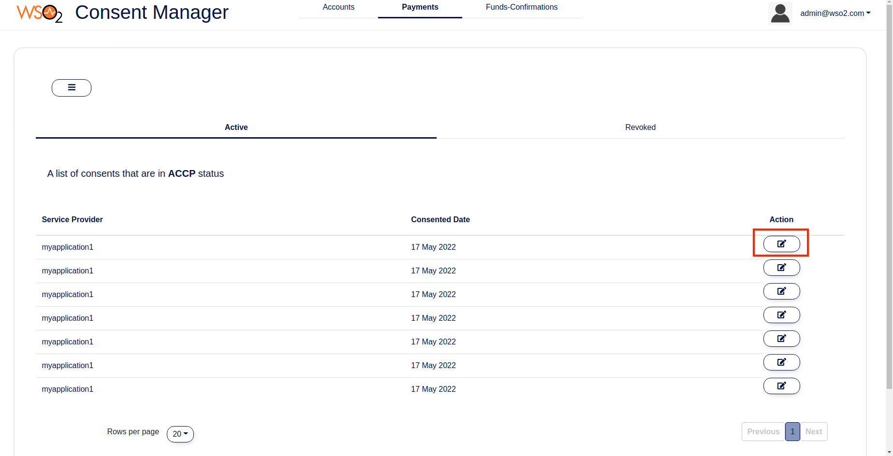

* You can view the details such as the associated API consumer application, consent granted date, consent expiry date, account numbers, and permissions that you have granted.

  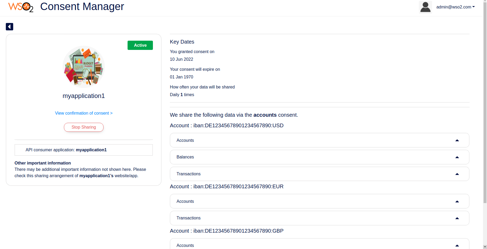

### Revoking a consent[​](#revoking-a-consent "Direct link to Revoking a consent")

* To revoke a consent, review the details and click **Stop Sharing**.

  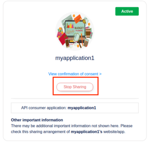

* Revoking a consent consists of 2 steps:

  * Step 1: The first step shows the impact of revoking the consent.

    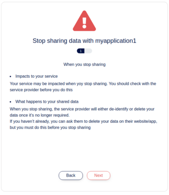

  * Step 2: Displays the information the consent has access to.

    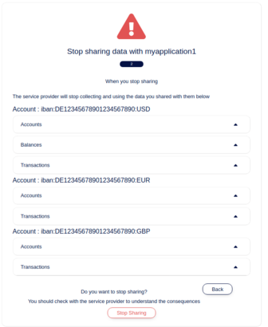

  * Once you click **Stop Sharing**, the status of the consent changes to `revoked`.

    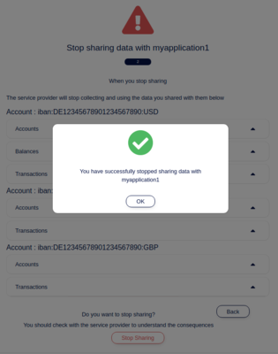

* You can find this consent in the **Revoked** tab now.
