# Deploy NextGenPSD2XS2A API

This page provides instructions to deploy the NextGenPsd2XS2AFramework API. NextGenPSD2 Reference Toolkit provides the Account Information Service (AIS), Payment Initiation Service (PIS), and Confirmation on the Availability of Funds Service (FCS) via the NextGenPSD2XS2AFramework API.

1. Sign in to the API Publisher Portal at `https://<APIM_HOST>:9443/publisher` with the creator/publisher privileges.

   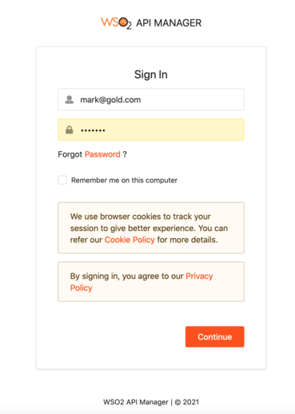

2. In the homepage, go to **REST API** and select **Import Open API**. 

3. Select **OpenAPI File/Archive**. 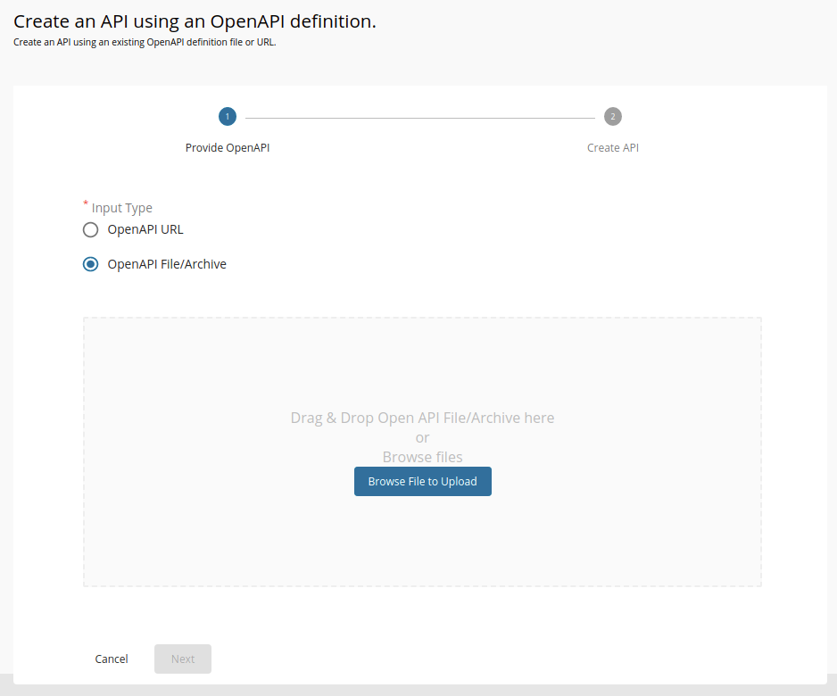

4. Click **Browse File to Upload** and select the `<APIM_HOME>/<OB_APIM_TOOLKIT_HOME>/repository/resources/apis/berlin.group.org/PSD2API_1.3.6/psd2-api_1.3.6_20200327.yaml` file.

5. Click **Next**.

6. Set the context to `/xs2a`.

7. Remove the existing endpoint configuration and leave the field empty. 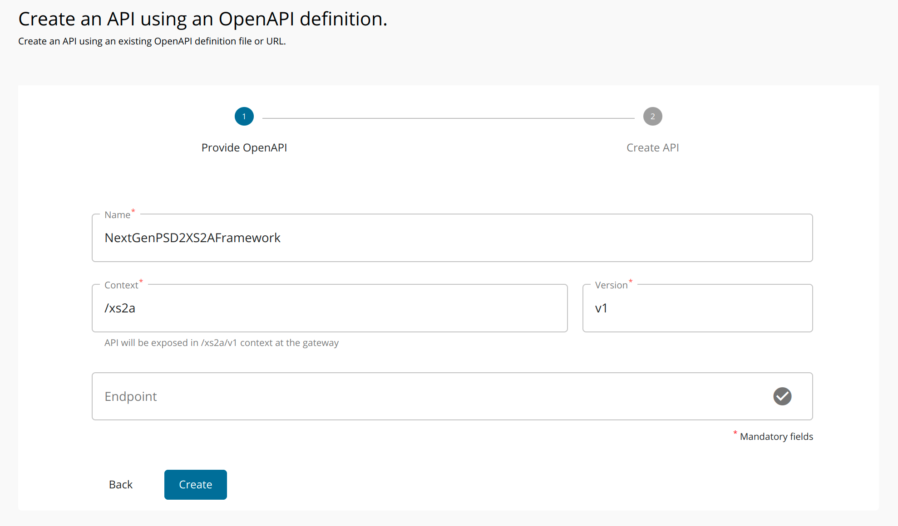

8. Click **Create** to create the API. 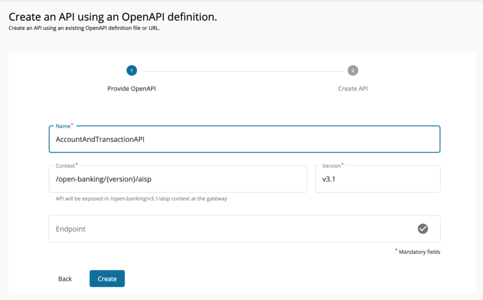

9. After the API is successfully created, go to **Portal Configurations** using the left menu panel. 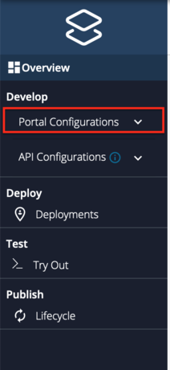

10. Select **Subscriptions** from the left menu pane and set the business plan to **Unlimited: Allows unlimited requests**. 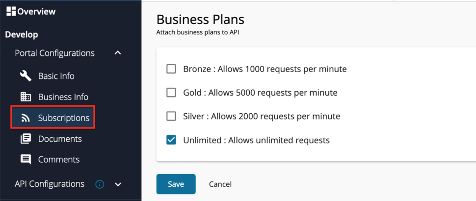

11. Click **Save**.

12. Select **Runtime** from the left menu pane.

13. Toggle the **Schema Validation** button to enable Schema Validation. 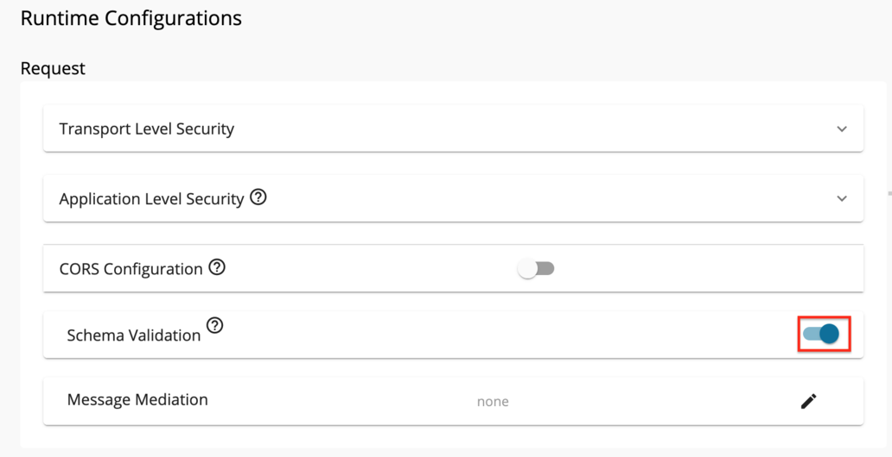

14. Go to **Develop -> API Configurations -> Policies** in the left menu pane to add a custom policy. 

15. On the **Policy List** card, click on **Add New Policy**.

16. Fill in the **Create New Policy**.

17. Upload the `<APIM_HOME>/<OB_APIM_TOOLKIT_HOME>/repository/resources/apis/berlin.group.org/PSD2API_1.3.6/dynamic-endpoint-insequence-1.3.6.xml` insequence file. 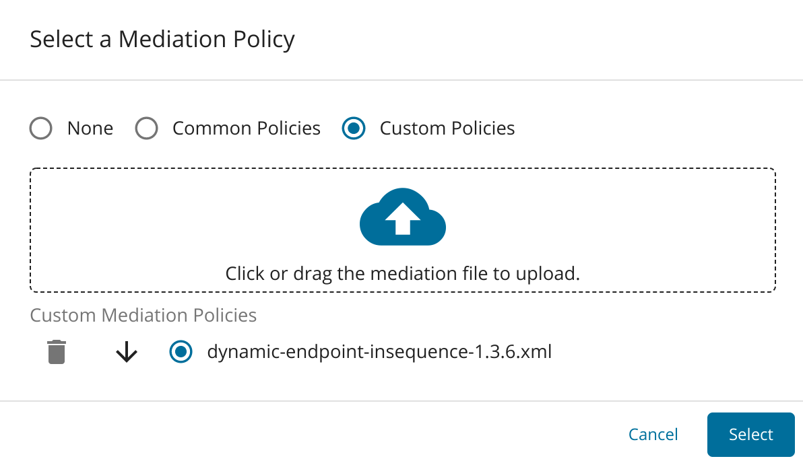

18. Scroll down and click **Save**. Upon successful creation of the policy, you receive an alert as shown below: 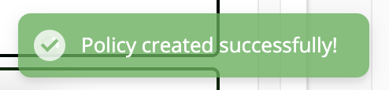

19. Expand the API endpoint you want from the list of API endpoints. For example: 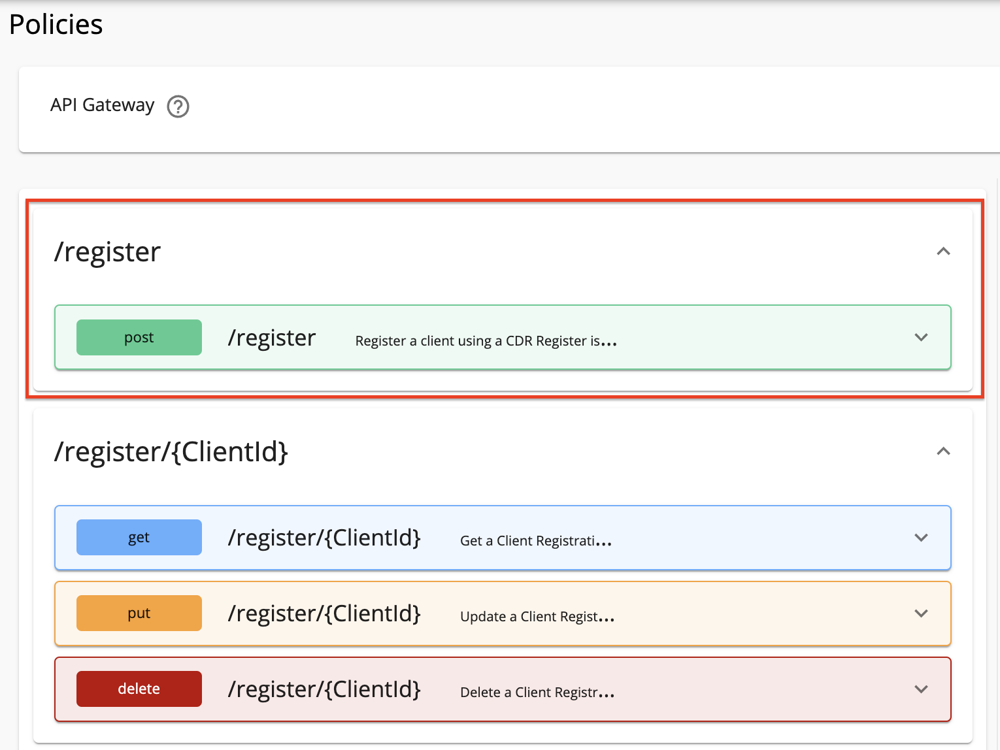

20. Expand the HTTP method from the API endpoint you selected. For example: 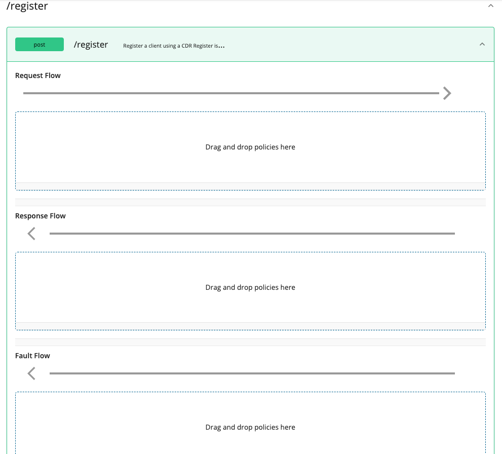

21. Drag and drop the previously created policy to the **Request Flow** of the API endpoint. 

22. Select **Apply to all resources** and click **Save**.

23. Scroll down and click **Save**.

24. Use the left menu panel and go to **API Configurations > Endpoints**.

    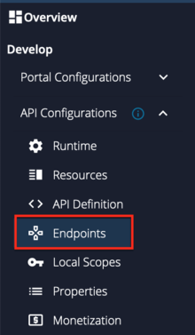

25. Add a **Dynamic Endpoint**. 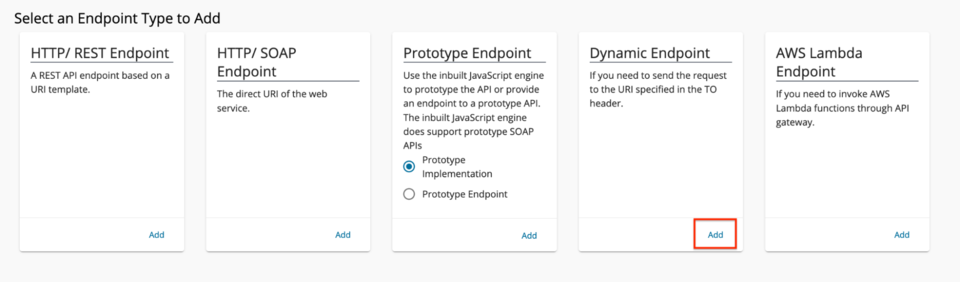

26. Go to **Deployments** using the left menu pane.

    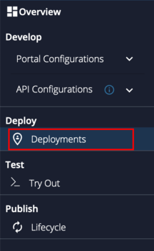

27. Select the API Gateway type, in this scenario, it is **Default**. 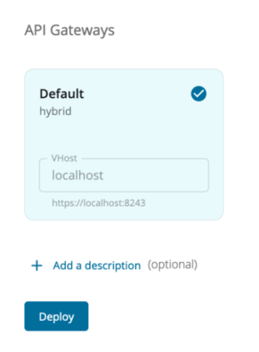

28. Click **Deploy**.

29. Go to **Overview** using the left menu pane.

    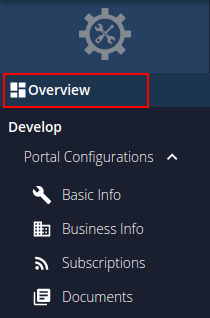 30. Click **Publish**. 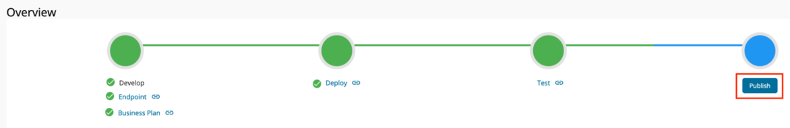
